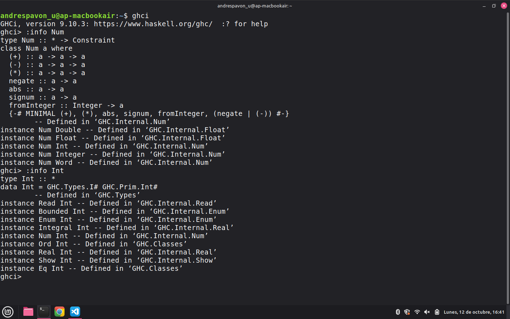
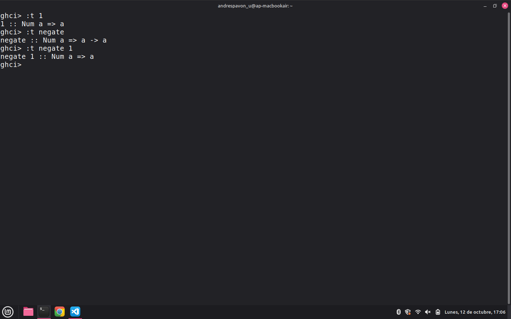

# Práctica 3: Mis tipos de dato y Listas por comprensión

## **Objetivo:**

- Familiarizarse con la distinción entre tipos de datos y clases de tipos, del lenguaje de programación Haskell, por medio de la investigación de tal distinción, así como verla en operación en la definición de funciones específicas. 
- Familiarizarse con la creación de tipos de datos propios, en el lenguaje de programación Haskell, aprendidendo a llevar a cabo la definición de los tipos. 
- Familiarizarse con el concepto de las *listas por comprensión*, necesario para el desarrollo de programas con funciones específicas que permitan manipular esta clase de listas.  

## **Tiempo requerido para llevar a cabo la práctica:** 

11 horas, aproximadamente. 

## **Ejercicio favorito:** 

En esta práctica, mi ejercicio favorito fue la definición de la función `cetes`, pues haciéndola aprendí el uso correcto de la condicional `if` (algo que, desafortunadamente, descuidé en la práctica anterior). 

## **Comentarios:** 

En la práctica anterior hice un uso ilegal de la función de evaluación de rangos con guardas, siguiendo un ejemplo que hallé en: 

- Dodino, F., Lombardi, C., Passerini, N. y Solmirano, D. (2024, abril). Paradigma funcional - Módulo 4: Recursividad. Evaluación diferida (Versión 2.1). Google Docs. [https://docs.google.com/document/d/1JOlRcFZ7Ehm9gx_wH77MkhvObcyKS7Wqo4Sm8joMJBM/edit?tab=t.0#heading=h.xtpxwvpvaqiq]

En esta nueva ocasión, observando estrictamente los lineamientos establecidos, logré una definición similar (la de la función `cetes`) usando solamente los operadores y las funciones legales (en este caso: la condicional `if`), y por medio de la creación de un tipo de dato propio, siguiendo las recomendaciones del profesor Irvin J. Cruz González. 

Por otra parte, en esta práctica hago uso de algunas funciones auxiliares, importadas por medio de un módulo, cuales son las funciones `esParBin` y `divisores` (ambas de estas analizadas en la última sesión de laboratorio), y las funciones `esPrimo` y `sonCoprimos`. Esto con el propósito de facilitar la definición de algunas de las funciones principales y mantener el código fuente bien ordenado por medio de la encapsulación de las funciones auxiliares. 

## **¿Cuál es la diferencia entre `Num` e `Int`?**

La diferencia específica entre uno y otro es que `Int` es un tipo de dato, mientras que `Num` es una clase de tipos. 

- En tanto clase de tipos, `Num` es una conjunto al cual pertenecen tipos distintos (sus instancias). 
    - `Num` define así un conjunto de comportamientos que cualquier tipo de la clase (cualquier instancia) debe tener. 

- `Int` es un tipo de dato, una instancia de la clase de tipos a la cual pertenece: la clase `Num`.  
    - Representa valores numéricos enteros de tamaño fijo. Esto quiere decir que ocupan una cantidad determinada de bits de memoria. 

## ***Exempli gratia:***
En la siguiente imagen se puede ver que la información relativa a `Num` comienza con la palabra "class", señalando así que es una clase. 
Se puede ver, además, que `Int` aparece como una de sus instancias. 

Por otra parte, se puede ver que la información relativa a `Int` comienza con la palabra "data", señalando así que es un tipo de dato. 

En la segunda imagen se puede ver que al consultar el tipo del literal `1` y de la función `negate`, `Num` no aparece directamente como el tipo de dato del valor, sino como una restricción a la izquierda del símbolo `=>`. 

Se puede ver, además, que la restricción se aplica a la variable de tipo `a`, de manera que tanto `1` como el resultado de evaluar `negate 1` solo pueden ser de los tipos que pertenecen a la clase Num (como Int, Integer o Double). 

## **Bibliografía:**

- *Conventional Commits*. (2019). Conventional Commits 1.0.0 [Especificación técnica]. https://www.conventionalcommits.org/en/v1.0.0/
- Lipovača, M. (2011). Making our own types and typeclasses. En *Learn You a Haskell for Great Good!* https://learnyouahaskell.github.io/making-our-own-types-and-typeclasses
- Marlow, S. (Ed.). (2010). *The Haskell 2010 language report*. Haskell.org. https://www.haskell.org/onlinereport/haskell2010/